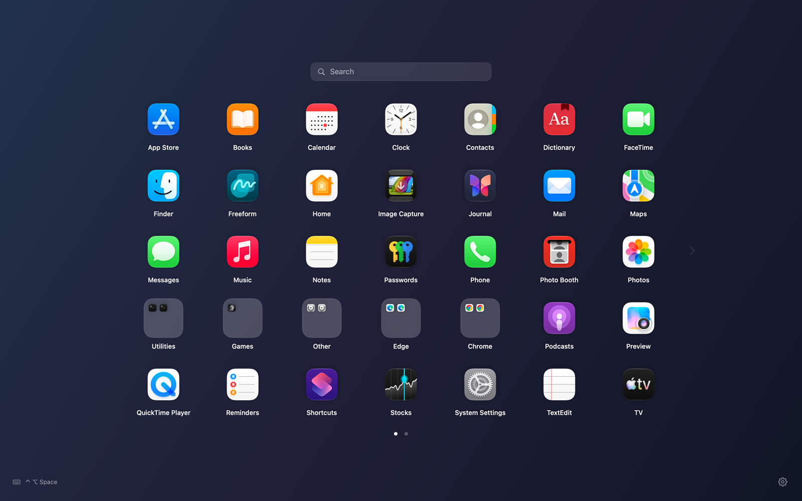

# LaunchTablet

[简体中文](README.zh-CN.md)

A native macOS app launcher built with SwiftUI and AppKit, designed for large displays. The latest release is **1.0.3**; packaged builds target **Apple Silicon**, with a minimum deployment target of macOS 14. This page describes the current source; see the release notes for the published package.

This is an independent community project and is not affiliated with or endorsed by Apple. The interface supports English and Simplified Chinese, following the system by default with an instant language switch in Settings.

Apple, Microsoft Edge, Google Chrome, and the app icons shown in the preview belong to their respective owners. The MIT license applies to this project's code and original assets.

The preview renders the actual interface offscreen using sample apps, without personal app lists or wallpaper.

## Features

- A fullscreen background with five grid areas: **Full screen**, **14-inch** (default, up to 1120 × 790 logical points), **16-inch** (up to 1280 × 900), **24-inch** (up to 1920 × 1080), and **27-inch** (up to 2160 × 1215). Change the area instantly in Settings; the choice is saved. Full screen scales icons and labels with the available area, leaves roughly 10% margins on each side and 5% above and below, and adds more side space on ultrawide displays. All modes shrink on smaller screens. Named sizes are layout presets, not physical screen measurements.
- Page animations extend to the screen edges in Full screen mode. Other presets add one column of transition space on each side, limited by the physical screen. Resting grids stay centered without showing neighboring pages. The 24-inch and 27-inch presets also scale icons and labels with the available area.
- Horizontal pagination, search by name or pinyin, keyboard navigation, and layered Escape handling.
- Drag apps or folders to reorder with insertion guides. Drop onto folders, hover to open them, or move apps between folders. Escape cancels the drag. Layout and hidden apps are saved locally.
- The launcher settles from 112% scale to its normal size when opened, and enlarges while fading out when dismissed. Folder and hidden-app transitions also respect Reduce Motion.
- Default folders for utilities, games, and system helpers. Web apps from Edge Apps and Chrome Apps directories get separate browser folders.
- Changes in application directories and their subdirectories trigger a background refresh; newly installed apps join the current layout automatically.
- Apple apps appear first; third-party apps use an estimated installation order. Manual arrangements are preserved.
- Starts in the background without showing a window. Pin LaunchTablet to the Dock and click its icon, or use **Control + Option + Space**, to show it on the display containing the pointer. As an accessory app, it does not add a running icon to the Dock automatically.

## Build and run

Use macOS with **Swift 6 or newer** and a matching macOS SDK. Scripts follow the current developer tools selected by `xcode-select`, and honor `DEVELOPER_DIR` and `SDKROOT` without changing system settings.

| Command | Result |
| --- | --- |
| `sh scripts/run.sh` | Run from source |
| `sh scripts/test.sh` | Run Swift Testing checks |
| `sh scripts/build-app.sh` | Build `dist/LaunchTablet.app` for arm64 |
| `sh scripts/build-dmg.sh` | Build a DMG and SHA-256 checksum in `dist/` |
| `sh scripts/export-preview.sh` | Render the documentation preview using isolated sample data |

If your compiler and SDK do not match, select a compatible developer tools installation with `DEVELOPER_DIR`; optionally supply `SDKROOT`. Complete any required Xcode first-launch setup yourself.

The local CLT installation's default macOS 27 SDK lacks the `SwiftUIMacros` plugin. Full Xcode builds successfully; CLT was also verified with its bundled macOS 26.5 SDK. If you encounter that error, use full Xcode or a matching SDK. Scripts do not silently downgrade the SDK.

The internal secondary-display test build is produced by `sh scripts/build-app.sh --test-secondary` in `.build/ui-testing/`. It uses a separate bundle identifier and will not fall back to the main display. Its layout is isolated in `.build/ui-testing/layout.json`, and it does not register a global shortcut.

## Install

Download the DMG and optional SHA-256 checksum from [GitHub Releases](https://github.com/luckalphie/LaunchTablet/releases/latest). Open the DMG, drag LaunchTablet into Applications, eject the image, and launch the installed copy. Quit the previous version before replacing it.

The 1.0.3 package is ad hoc signed and **not notarized**. macOS may block a downloaded copy; after trying to open it, use **System Settings → Privacy & Security → Open Anyway** if you trust the sender. There is no need to disable system security.

## Status and limitations

- Local development and desktop checks use Apple Silicon and macOS 27. The macOS 14 deployment target is not a claim that every supported OS version has been tested.
- 72 local checks cover application directory changes, agent application discovery, grid area preferences, layout, migrations, search, keyboard behavior, and simulated scrolling. Real trackpad gestures and the updated native drag interactions still need further desktop validation.
- App categories and installation dates come from system metadata and may be missing or inaccurate.
- Packaged builds are arm64 only. Intel packages are not provided.
- GitHub Actions checks shell scripts, runs tests, and compiles an arm64 executable. See the [hosted build results](https://github.com/luckalphie/LaunchTablet/actions).

## Language and upgrades

Choose **System default**, **简体中文**, or **English** under **Settings → Language**. The choice is saved and updates the interface, menus, hints, errors, and accessibility labels immediately. Unsupported system languages fall back to English. Default category labels are translated; custom folder names and installed app names are preserved.

When upgrading from the old Launchpad project name, LaunchTablet reads the old layout only if no new layout exists. The next save writes to the LaunchTablet directory and preserves the old file. Existing new settings and layout take priority, and the packaged app migrates the old shortcut preference.

## Privacy

The app reads local app metadata and icons for display and search, and the current display's wallpaper for its blurred background. It contains no networking, telemetry, or analytics code.

Layout, folder names, hidden apps, and observed installation dates are stored in `~/Library/Application Support/LaunchTablet/layout.json`. Shortcut, interface language, and grid area preferences use macOS user defaults. Changing the grid area does not rewrite your arrangement. Apps without a bundle identifier use their local path as an ID, so review layout files before sharing them in an issue.

Carbon registers the selected global shortcut; other keyboard and scroll handling stays within this process. The app does not require Accessibility, Input Monitoring, or Screen Recording permission.

## Contributing and license

See [Contributing](CONTRIBUTING.md) and the [Java developer guide](docs/开发导读.md), currently in Chinese. The project is licensed under the [MIT License](LICENSE).

Build products, local Xcode workspace state, and the `dist/` directory are excluded from Git. Publish downloadable DMGs and checksums through GitHub Releases.
